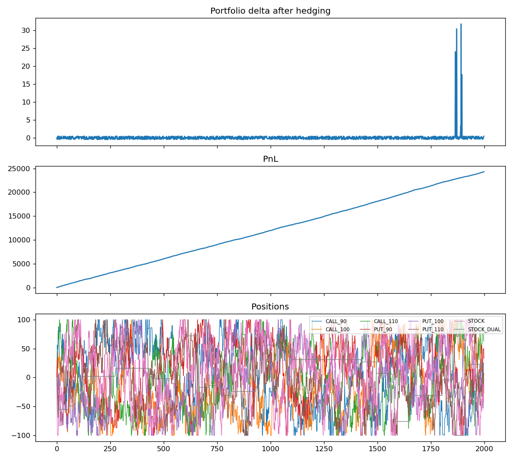

# Options Market Making with Delta Hedging


An automated options market maker: it prices each option with Black-Scholes, places
inventory-aware two-sided quotes around that fair value, and delta-hedges the book with the
underlying stock across two listings.

It started as a group project for the *Algorithms in Finance* course (MSc Banking & Finance,
Utrecht University, 2024), where the bot traded live on Optiver's Optibook exchange.
Our team finished **2nd in the course's Optiver algorithmic-trading competition**.

This repository is a standalone rewrite: the course exchange is private, so it includes a
simulated options exchange with the same interface, fixes the bugs in the original notebook
and adds a test suite (53 tests).

## How it works

```
every tick:
  S = mid price of the primary stock listing
  for each option:
      cancel resting orders
      fair, delta = Black-Scholes(S, K, T, r, sigma)
      (bid, ask)  = compute_quotes(fair, market best bid/ask, inventory)
      volume      = quote_volume(fair, market best bid/ask)
      insert limit orders (capped so a fill can never breach the ±100 limit)
  total delta = sum(option position x option delta) + stock held in both listings
  trade the primary listing to bring delta to zero; spill over to the dual listing at its limit
```

**Quoting** (`quoting.py`)

* Normally improve the best bid and best ask by one tick, but never quote through fair value
  (bid ≤ fair - tick, ask ≥ fair + tick).
* Inventory threshold (default 60 lots): when long beyond it, stop improving the bid and offer
  at fair + tick to sell inventory down; when short, the mirror image.
* Size grows with the available edge: 30 / 60 / 90 lots for 1 / 2 / 3 ticks between fair value
  and the far side of the market, 100 above that.

**Hedging** (`hedging.py`): the stock has delta 1, so the hedge brings
option delta + stock position to zero. The liquid primary listing is used first; the
less liquid dual listing gives another 100 lots of hedging capacity when the primary is at its
limit.

## Quick start

```bash
git clone https://github.com/Amir-Shokat/options-market-making.git
cd options-market-making
pip install -e ".[dev]"
pytest

python scripts/run_simulation.py                                   # model vol = market vol
python scripts/run_simulation.py --model-vol 0.30 --market-vol 0.45  # mis-specified volatility
```

```
model vol = market vol:   fills=11184  final PnL= 24293.00  |delta| p95=0.48
model vol 0.30 vs 0.45:   fills= 1490  final PnL=  -132.55  |delta| p95=0.47
```



Delta stays close to zero throughout. The short spikes near the end happen when both stock
listings are at their ±100 limits, so the book can't be fully hedged. The PnL line is
optimistic: simulated takers arrive at random and are not informed, so there is no adverse
selection. The second run shows the main real-world risk: when the volatility the bot prices
with is wrong, its quotes sit on the wrong side of the market, fills dry up and the edge
disappears.

## Project layout

```
src/options_mm/
    black_scholes.py   prices, delta, gamma, vega (checked against finite differences and put-call parity)
    quoting.py         inventory-aware bid/ask and size
    hedging.py         delta hedge across primary + dual listing
    market_maker.py    the trading loop
    exchange.py        simulated options exchange (Optibook-compatible subset)
scripts/run_simulation.py
tests/
```

## Changes from the original coursework

| Original notebook | Now |
|---|---|
| `calculate_volume_for_options(best_ask, best_ask, ...)` passed the ask price twice, so size never reflected the bid-side edge | Correct arguments, plus a test for each size tier |
| With the fair value at the best bid, the bot bid `best_bid + 0.1`, *above* fair value (a guaranteed-loss quote) | Quotes are clamped to at least one tick inside fair value |
| `bid_price` could be undefined in some inventory branches, raising `UnboundLocalError` | Every branch returns a quote, or `None` when no two-sided quote makes sense |
| An order that might breach the limit was skipped entirely | Quote the largest size that cannot breach the limit |
| Relied on private `black_scholes` / `libs` modules from the course | Own Black-Scholes implementation with Greeks and tests |
| Fixed `sigma = 3`, the value given on the course exchange | Volatility is a parameter; the simulation shows what happens when it is wrong |

**Possible extensions** (also noted in the original report): gamma and vega hedging, and
hedging with futures when they are cheaper than the stock.

## Credits

The original was a five-person group project; the strategy and report were joint work. This
repository is my own rewrite and extension.

## License

MIT
